<div align="center">

# ◆ me

**Your coding agent, everywhere.**
One Python file. Everything synced. Open source.

**English** · [Русский](README.ru.md)

[me-agent.ru](https://me-agent.ru) · [Web app](https://me-agent.ru/app) · [Account](https://me-agent.ru/account) · [Marketplace](https://me-agent.ru/market) · [Releases](https://github.com/Gl1ch5/Me-agent/releases)

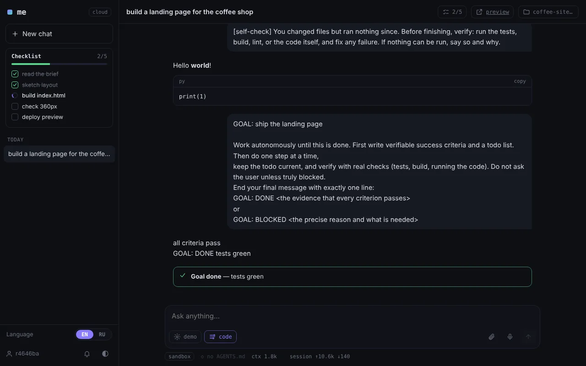

</div>

```sh
curl -fsSL https://me-agent.ru/i | sh       # macOS · Linux · Android (Termux)
irm https://me-agent.ru/i.ps1 | iex         # Windows
```

Then type `me`. Needs Python 3.8+, nothing else. The interface is available in **English and Russian** (auto-detected, switchable everywhere: site, account, web app).

---

## Contents

[Trust](#trust) · [Why me](#why-me) · [A tour](#a-tour) · [Everything it can do](#everything-it-can-do) · [Commands](#commands) · [Usage](#usage) · [Self-hosting](#self-hosting) · [Development](#development)

---

## Trust

> **me is built on trust, not on secrecy.**

Everything is open: the client (`me.py`, built from `src/`), the web UI, the server (`server/`) and the deploy files. Anyone can read them, and anyone can run the server part on their own machine. Nothing in the code is hidden from you.

**What the hosted server at me-agent.ru holds, stated plainly:**

| Data | How it is stored |
|---|---|
| Login | as is |
| Password and session tokens | hashed |
| Synced config, including provider API keys | **unencrypted** on the server |
| Chats and project files | **unencrypted** on the server |

The operator of a server can read what is stored on it. If that is not acceptable for you, [run your own server](#self-hosting), or keep the keys you care about out of the cloud config. Accounts do not share data with each other.

**Marketplace skills run on your machine** and may install Python packages. Read a skill's code before you install it. The local `me web` server only answers requests that come from your own machine.

Found a security problem? Open a GitHub issue marked `security`, or reach the maintainer through this repository.

---

## Why me

Every agent makes you rebuild your setup on each machine. **me** keeps your models, API keys, prompt, skills, plugins, themes, agents, chats **and project files** in your account. Open a terminal, a browser tab, the phone app or Telegram, and you continue exactly where you left off, live.

It is also **tiny on purpose**: the system prompt and tools take about 1k tokens at start (many agents spend 10–20k before you say hello). Skills, plugins and MCP servers cost almost nothing until the model needs them.

## A tour

### Chat in the browser, on any screen

`me web` opens a local chat UI, and the cloud `/app` runs the same UI against a sandbox on the server. It is an installable PWA: attach images and files from the phone, get a push notification when a task is done, open the site the agent built by link.

<table>
<tr>
<td width="62%"></td>
<td width="19%">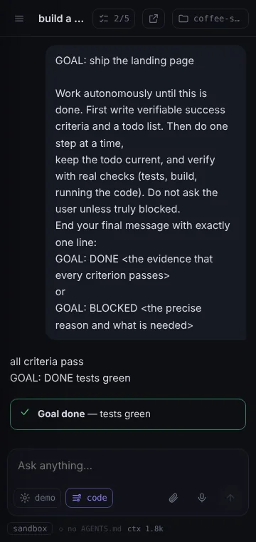</td>
<td width="19%">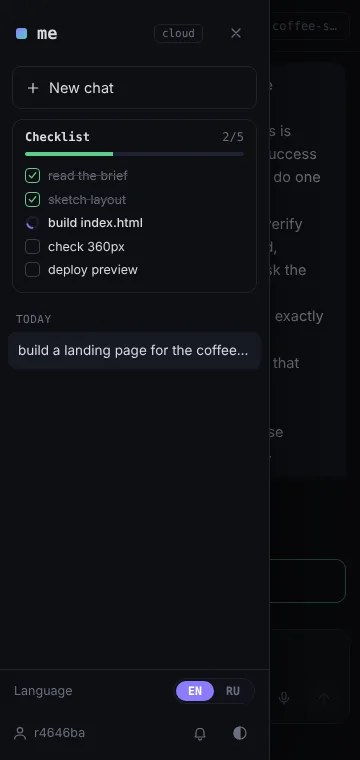</td>
</tr>
</table>

### The terminal UI

A full-screen TUI that works in any terminal, including Termux on Android: fuzzy slash-command suggestions, `@file` completion, diffs, collapsible tool cards, a context meter.

<table>
<tr>
<td>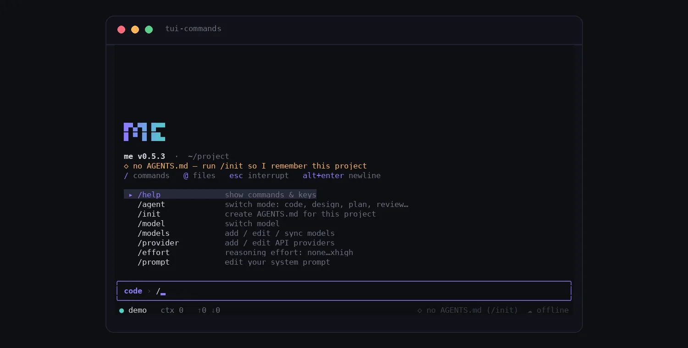</td>
<td>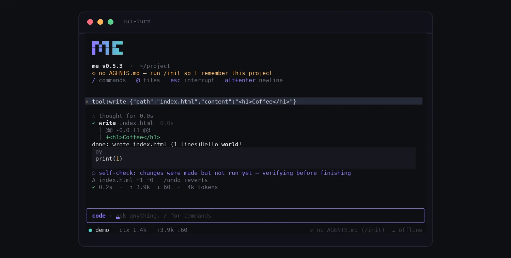</td>
</tr>
</table>

### One account for everything

The account page is the control room for what follows you from machine to machine.

<table>
<tr>
<td width="50%"><b>Overview</b><br>devices, synced data, install commands<br>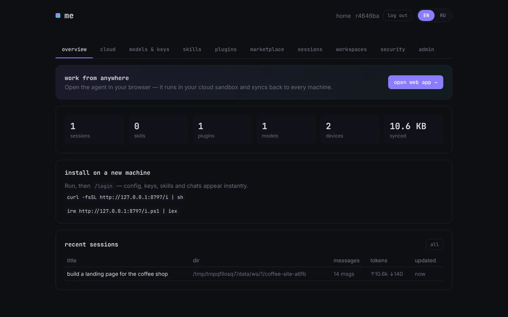</td>
<td width="50%"><b>Models &amp; keys</b><br>providers, models, reasoning effort, secrets<br>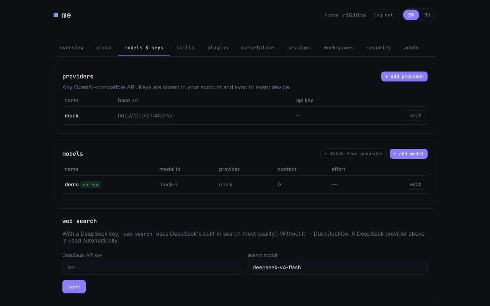</td>
</tr>
<tr>
<td><b>Cloud</b><br>sandboxes, Telegram bot, GitHub, push, background jobs<br>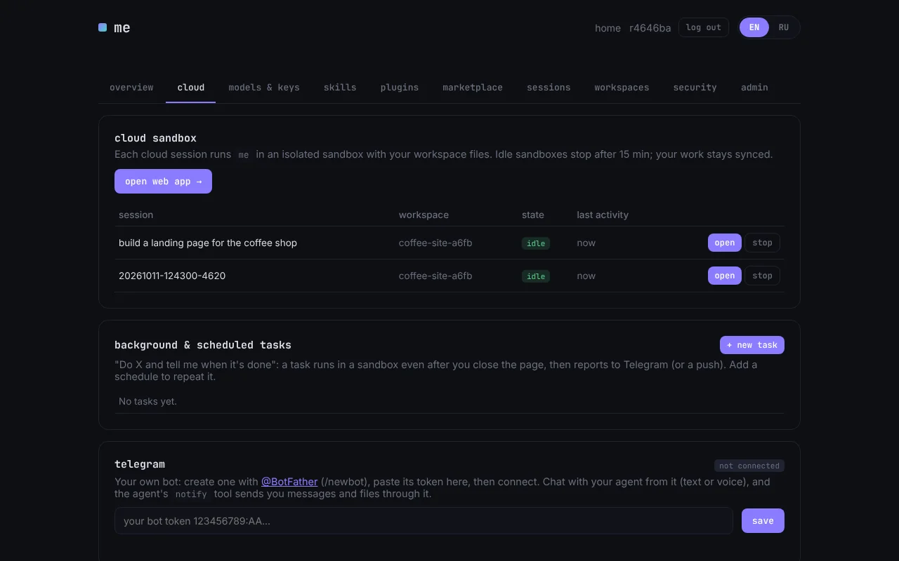</td>
<td><b>Skills</b><br>create, edit, enable, share<br>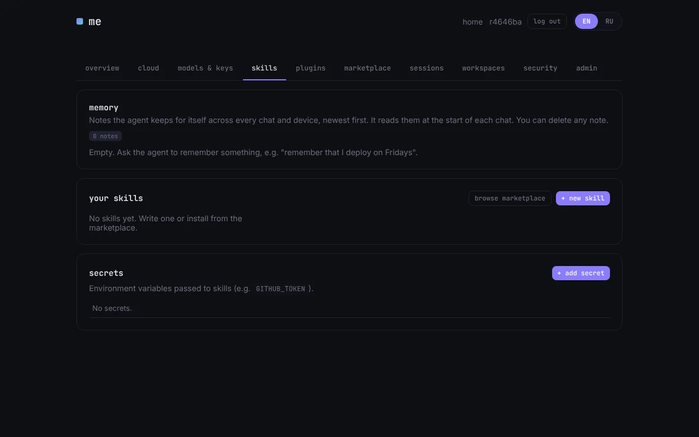</td>
</tr>
<tr>
<td><b>Marketplace</b><br>skills, plugins, themes and agents with ratings, versions and auto-update<br>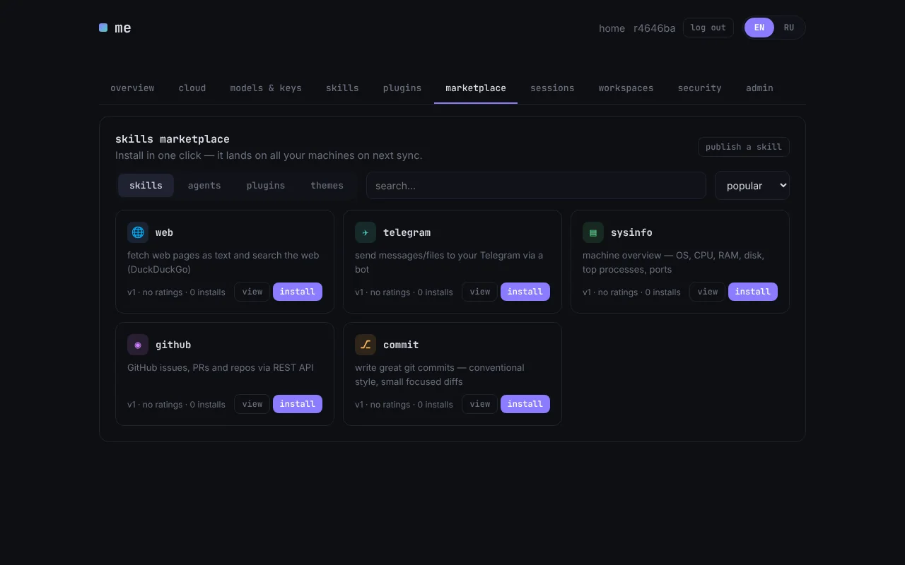</td>
<td><b>Sessions</b><br>read any chat from any machine<br>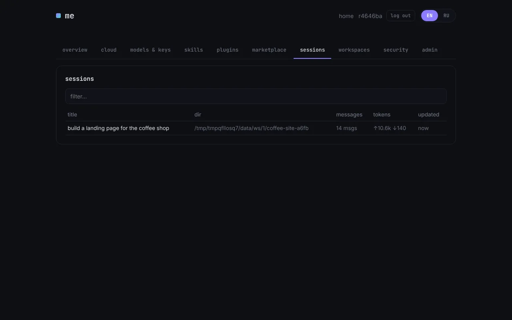</td>
</tr>
<tr>
<td><b>Workspaces</b><br>project files synced to the cloud, with a file browser<br>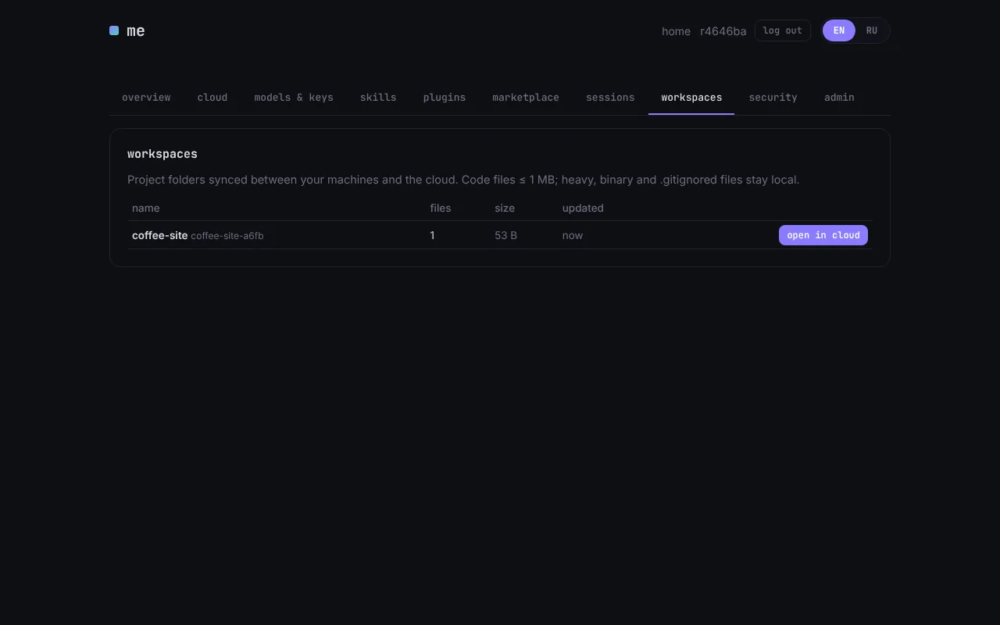</td>
<td><b>Security</b><br>2FA, password, device list with revoke<br>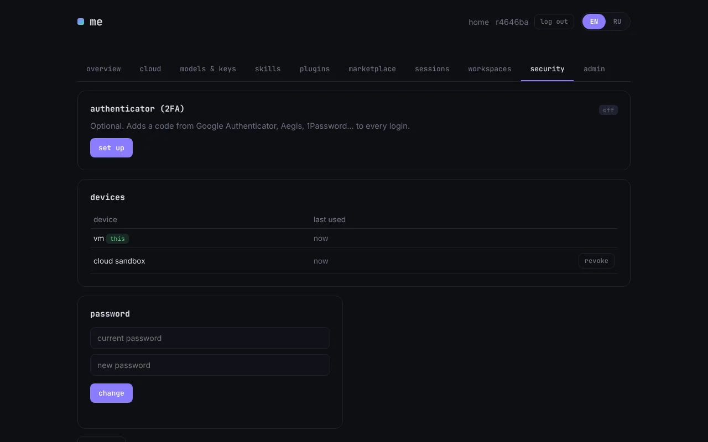</td>
</tr>
</table>

### Themes

Terminal, web app and site share one palette. Pick one with `/theme` (live preview) or install more from the marketplace.

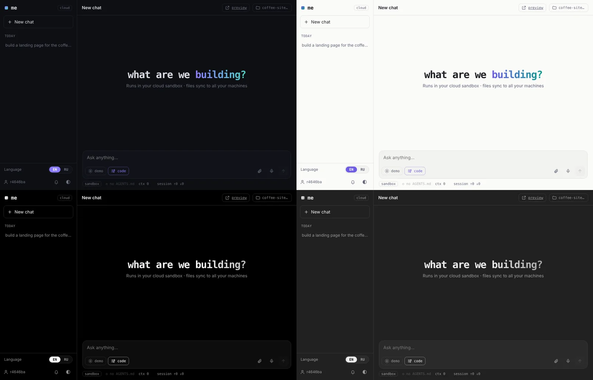

---

## Everything it can do

### Agent

| | |
|---|---|
| **One file, no dependencies** | `me.py` is stdlib-only Python 3.8+. About 1k tokens of system prompt and tools at start. |
| **Any model** | Any OpenAI-compatible API: chat/completions or responses, streaming, reasoning effort (none → xhigh), custom model names and context sizes, model list sync from a provider. |
| **Agent modes** | `code` · `design` (writes DESIGN.md first, tokens and components, checked at 360 and 1280 px) · `plan` (writes PLAN.md, no code changes) · `review` (read-only, real bugs only) · `debug` (reproduce, root cause, prove) · `docs` · `research`. The marketplace adds devops, tester, security, mobile, and you can write your own as a `.md` file. |
| **Goals** | `/goal "…"` works autonomously until the goal is done **and verified**, or reports exactly why it is blocked. Exits 0 or 2 in headless mode, so it works in CI. |
| **Plans and todo** | A live `todo` checklist in the terminal and the web UI. The agent self-checks (tests, build, lint, running the code) before it says "done". |
| **Subagents** | `task(agent, prompt)` runs any mode in a fresh context and returns a short report. |
| **AGENTS.md** | Always loaded into the session and shown in the UI. `/init` writes it and the agent keeps it current. `ME.md`, `CLAUDE.md`, `DESIGN.md` and `PLAN.md` are picked up too. |
| **Safe edits** | Multi-edit and line-range patches with clear errors for weak models. A checkpoint per turn: `/undo` restores the files of the last turn, and the web UI shows the diff with keep or revert. |
| **Permissions** | read-only · ask · full access, plus a command allow-list ("always allow `npm test`"). |
| **Context** | Context meter, `/compact`, and `/autocompact` before the window fills up. |
| **Cost** | Price table per model, prompt caching, parallel read-only tools. Cost per task, session and day, with optional limits (`/cost`). |
| **Search and fetch** | `web_search` through DeepSeek's built-in search (DuckDuckGo fallback) and `web_fetch`. |

### Extend

| | |
|---|---|
| **Skills** | One `.py` file is a guide plus actions with live progress, questions to the user (`ctx.choose`), tables and secrets. Not MCP: about 15 tokens idle. Actions run in a separate process. Create from a template, ask the agent to write one, or install from a URL. |
| **Plugins** | Change me itself: commands, tools, keys, status bar, themes. Voice input (hold space, Groq Whisper) ships as one. |
| **MCP** | Any MCP server, loaded lazily like a skill: one line idle, schemas on demand. |
| **Marketplace** | Skills, plugins, themes and agents with ratings, versions and optional auto-update. Publish your own. |
| **Themes** | me-dark, me-light, mono, mono-light, graphite, plus Nord, Tokyo Night, Gruvbox, Catppuccin, Rosé Pine and more from the marketplace. |

### Cloud and sync

| | |
|---|---|
| **Cloud sync** | Config, providers, keys, system prompt, skills, plugins, themes, agents and every chat follow your account. Last write wins per document. |
| **Live sync** | Every agent step is saved and pushed. Other devices update within a second, so you can watch a session from your phone. |
| **Workspaces** | A project folder is synced to the cloud with a three-way merge. Heavy and ignored files are skipped. Browse and clone it from the account page. |
| **Cloud sandbox** | Sessions run isolated on the server (bubblewrap, resource limits). Start on the laptop, continue on the phone. Sandboxes survive server restarts. |
| **Background tasks** | "Do X and notify me": the task keeps running after you close the page. Cron-style schedules, push and Telegram when it is done. |
| **Preview** | The site the agent built opens on your phone by link: static files, or the sandbox dev server on `$PORT`. |
| **GitHub** | A token in the account lets the agent clone into a workspace, branch, commit, push and open pull requests. |
| **Telegram** | Your own bot per account. Chat with your agent from it (text or voice), answer its questions with buttons, and let its `notify` tool send you messages and files. |
| **Push notifications** | Web Push when a task finishes and nobody is watching. |
| **Voice** | Dictation in the terminal (hold space) and in the web UI, transcribed by Groq Whisper with your own key. |
| **Accounts** | Username and password, optional 2FA (Google Authenticator, Aegis, 1Password), password change, device list with revoke. |
| **Self-hosting** | The whole backend is in this repository. Point `ME_SERVER` at your own server. |

### Everywhere

TUI (compact on narrow terminals) · `me web` on localhost · cloud web app (PWA) · Windows desktop app · Android app · Telegram · headless `me -p` and JSON-lines `me --rpc` for your own UI.

## Commands

Type `/` and start typing, suggestions are fuzzy.

| Command | What it does |
|---|---|
| `/help` | show commands and keys |
| `/agent` | switch agent (only `code` is built in; the rest come from the marketplace) |
| `/init` | create AGENTS.md for this project |
| `/goal` | work autonomously until done and verified, or blocked |
| `/todo` | show the agent's checklist |
| `/undo` | revert the files of the last turn |
| `/perm` · `/yolo` | permissions (read-only, ask, full) and the allow-list · toggle full access |
| `/cost` | spending: turn, session, today, limits |
| `/model` · `/provider` · `/effort` | switch model · add or edit API providers · reasoning effort |
| `/prompt` | edit your system prompt (synced) |
| `/skills` · `/plugins` · `/secret` · `/mcp` | skills · plugins · env secrets for skills · MCP servers |
| `/new` · `/sessions` · `/clear` | new session · resume a past one · clear the screen |
| `/compact` · `/autocompact` | compress the context now or automatically |
| `/workspace` | sync this project folder to the cloud |
| `/theme` | color theme (installable) |
| `/copy` | copy the last answer |
| `/login` · `/logout` · `/2fa` · `/sync` | cloud account · authenticator · sync now |
| `/config` · `/update` · `/quit` | settings · update me · exit |

## Usage

| Command | What it does |
|---|---|
| `me` | full-screen TUI, press `/` for commands |
| `me web [port]` | browser UI with the local agent (`--lan` for other devices) |
| `me -p "task" [-y]` | one-shot, headless |
| `me --rpc` | JSON-lines agent over stdio (what the cloud runner uses) |

`me -p '/goal "all tests pass"'` exits 0 only when the goal is done and verified (2 means blocked). Handy in CI.

## Self-hosting

The server is a FastAPI app in `server/`, with systemd and nginx files in `server/deploy/`. Run it on any Linux machine, then point the client at it:

```sh
export ME_SERVER=https://your-server.example
me
```

## Development

```
src/NN_*.py      the agent, split by concern (TUI = render / input / commands mixins)
src/web/         web UI: index.html + style.css + NN_*.js
build.py         src/ → me.py (single file, committed; CI checks it is fresh)
server/          FastAPI: accounts, TOTP, sync, workspaces, sandbox runner, Telegram, site
server/market/   built-in skills, plugins, themes and agents
apps/            desktop (pywebview) and Android (WebView) shells
tests/           test_core.py (offline) · test_cloud.py (needs a server) · test_restart.py · test_features.py (own server)
                 screenshots.py (playwright, every UI × 360/1280 × every theme) · measure_tokens.py (startup budget)
scripts/promo/   promo clips: pty+pyte terminal recorder, local stand, playwright web scenes, ffmpeg assembly
                 (scripts/build_promo.sh → dist/promo/; storyboards in docs/promo/SCRIPTS.md)
scripts/readme_shots.py   regenerates docs/screenshots/ (English and Russian)
```

Edit `src/`, run `python3 build.py`, then `python3 tests/test_core.py`.

---

<div align="center">

[Русская версия](README.ru.md)

</div>
