<div align="center">

# ◆ me

**Ваш агент для кода, везде.**
Один файл на Python. Всё синхронизировано. Открытый код.

[English](README.md) · **Русский**

[me-agent.ru](https://me-agent.ru) · [Веб-приложение](https://me-agent.ru/app) · [Аккаунт](https://me-agent.ru/account) · [Маркетплейс](https://me-agent.ru/market) · [Релизы](https://github.com/Gl1ch5/Me-agent/releases)

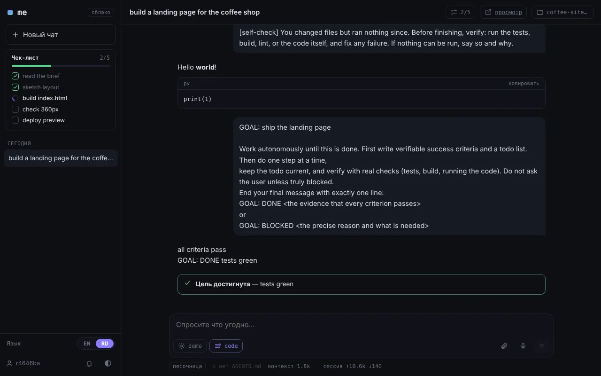

</div>

```sh
curl -fsSL https://me-agent.ru/i | sh       # macOS · Linux · Android (Termux)
irm https://me-agent.ru/i.ps1 | iex         # Windows
```

После установки наберите `me`. Нужен только Python 3.8+. Интерфейс есть на **русском и английском**: язык определяется автоматически и переключается везде (сайт, аккаунт, веб-приложение).

---

## Содержание

[Доверие](#доверие) · [Зачем me](#зачем-me) · [Обзор](#обзор) · [Всё, что он умеет](#всё-что-он-умеет) · [Команды](#команды) · [Использование](#использование) · [Свой сервер](#свой-сервер) · [Разработка](#разработка)

---

## Доверие

> **me построен на доверии, а не на секретности.**

Всё открыто: клиент (`me.py`, собирается из `src/`), веб-интерфейс, сервер (`server/`) и файлы развёртывания. Код можно прочитать, а серверную часть может запустить у себя любой. В коде ничего не спрятано.

**Что хранит размещённый сервер me-agent.ru, без обходных формулировок:**

| Данные | Как хранятся |
|---|---|
| Логин | как есть |
| Пароль и токены сессий | в виде хеша |
| Синхронизированный конфиг, включая ключи API провайдеров | на сервере **без шифрования** |
| Чаты и файлы проектов | на сервере **без шифрования** |

Владелец сервера может прочитать всё, что на нём хранится. Если вас это не устраивает, [поднимите свой сервер](#свой-сервер) или не храните в облачном конфиге ключи, которые вам важны. Данные разных аккаунтов не пересекаются.

**Навыки из маркетплейса работают на вашей машине** и могут ставить Python-пакеты. Прочитайте код навыка, прежде чем его устанавливать. Локальный `me web` отвечает только на запросы с вашей же машины.

Нашли проблему безопасности? Откройте issue в GitHub с пометкой `security` или свяжитесь с мейнтейнером через этот репозиторий.

---

## Зачем me

Любой агент заставляет заново настраивать всё на каждой машине. **me** хранит в вашем аккаунте модели, ключи API, промпт, навыки, плагины, темы, агентов, чаты **и файлы проектов**. Откройте терминал, вкладку браузера, приложение на телефоне или Telegram, и вы продолжите ровно с того места, где остановились, вживую.

Он ещё и **крошечный нарочно**: системный промпт и инструменты занимают около 1k токенов на старте (многие агенты тратят 10–20k, пока вы не сказали ни слова). Навыки, плагины и MCP-серверы почти ничего не стоят, пока модели не понадобятся.

## Обзор

### Чат в браузере, на любом экране

`me web` открывает локальный чат, а облачное `/app` запускает тот же интерфейс против песочницы на сервере. Это устанавливаемое PWA: можно прикреплять изображения и файлы с телефона, получать push, когда задача готова, и открывать собранный агентом сайт по ссылке.

<table>
<tr>
<td width="62%"></td>
<td width="19%">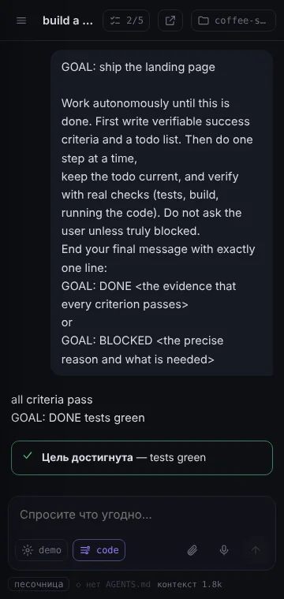</td>
<td width="19%">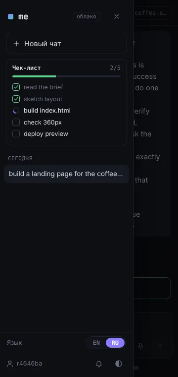</td>
</tr>
</table>

### Терминальный интерфейс

Полноэкранный TUI, который работает в любом терминале, включая Termux на Android: нечёткие подсказки команд, автодополнение `@файлов`, диффы, сворачиваемые карточки инструментов, индикатор контекста. Терминальный интерфейс пока только на английском.

<table>
<tr>
<td></td>
<td></td>
</tr>
</table>

### Один аккаунт на всё

Страница аккаунта — пульт управления всем, что следует за вами с машины на машину.

<table>
<tr>
<td width="50%"><b>Обзор</b><br>устройства, объём данных, команды установки<br>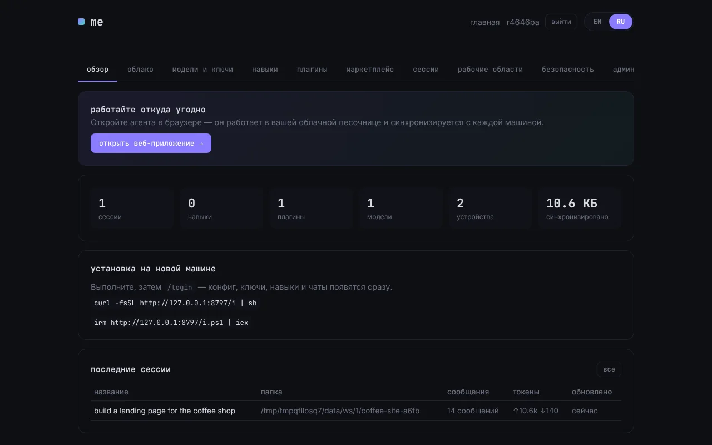</td>
<td width="50%"><b>Модели и ключи</b><br>провайдеры, модели, уровень рассуждений, секреты<br>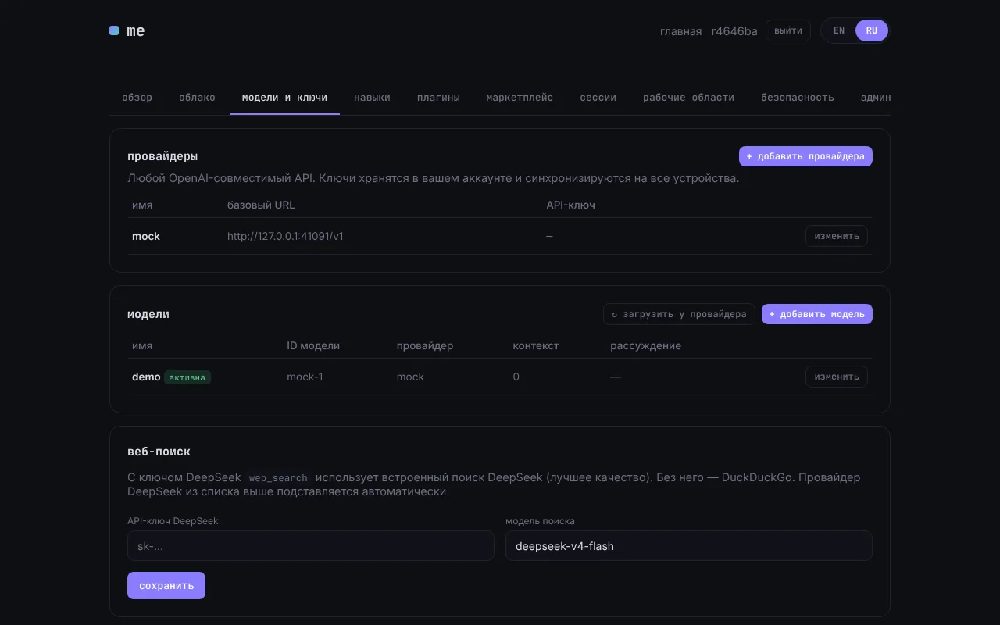</td>
</tr>
<tr>
<td><b>Облако</b><br>песочницы, Telegram-бот, GitHub, push, фоновые задачи<br>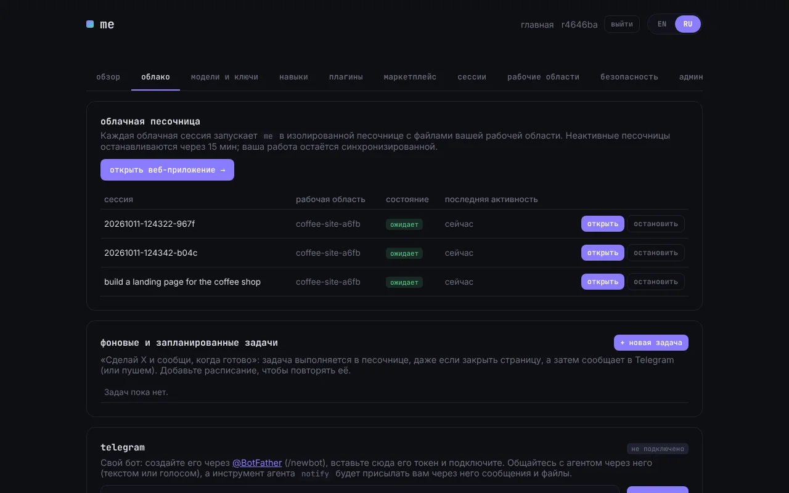</td>
<td><b>Навыки</b><br>создание, правка, включение, публикация<br>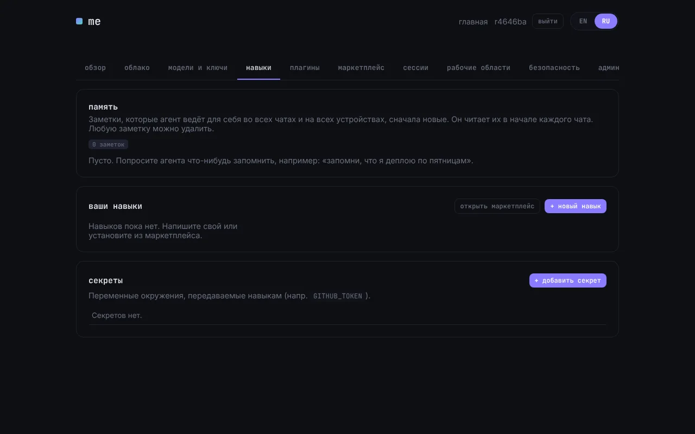</td>
</tr>
<tr>
<td><b>Маркетплейс</b><br>навыки, плагины, темы и агенты с рейтингами, версиями и автообновлением<br>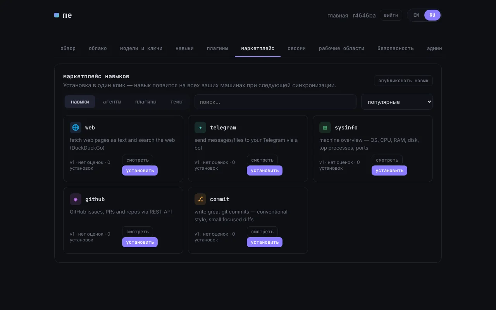</td>
<td><b>Сессии</b><br>читайте любой чат с любой машины<br>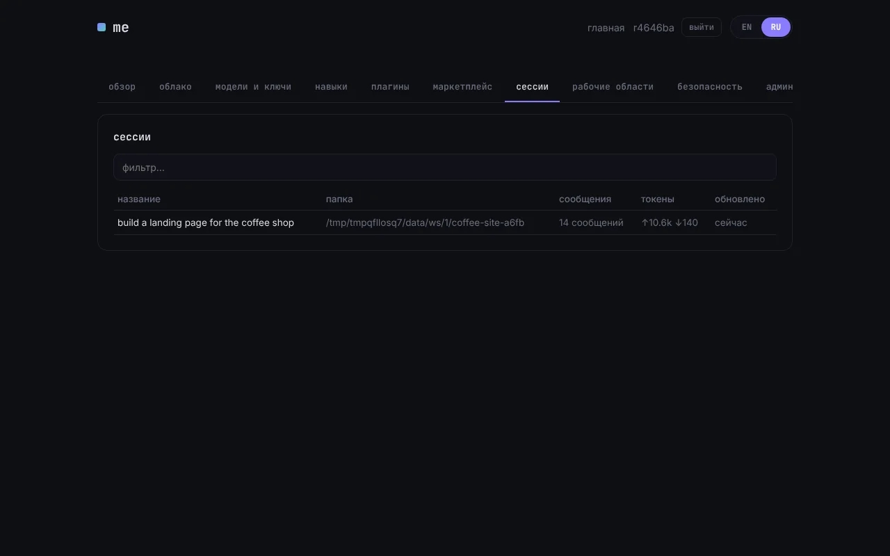</td>
</tr>
<tr>
<td><b>Рабочие области</b><br>файлы проектов в облаке, с просмотром файлов<br>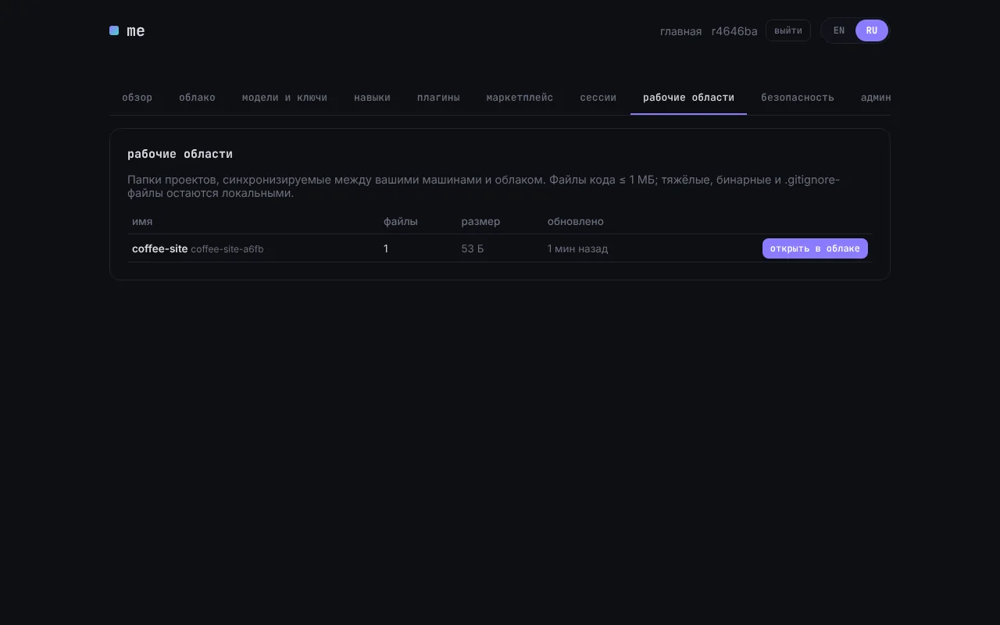</td>
<td><b>Безопасность</b><br>2FA, пароль, список устройств с отзывом<br>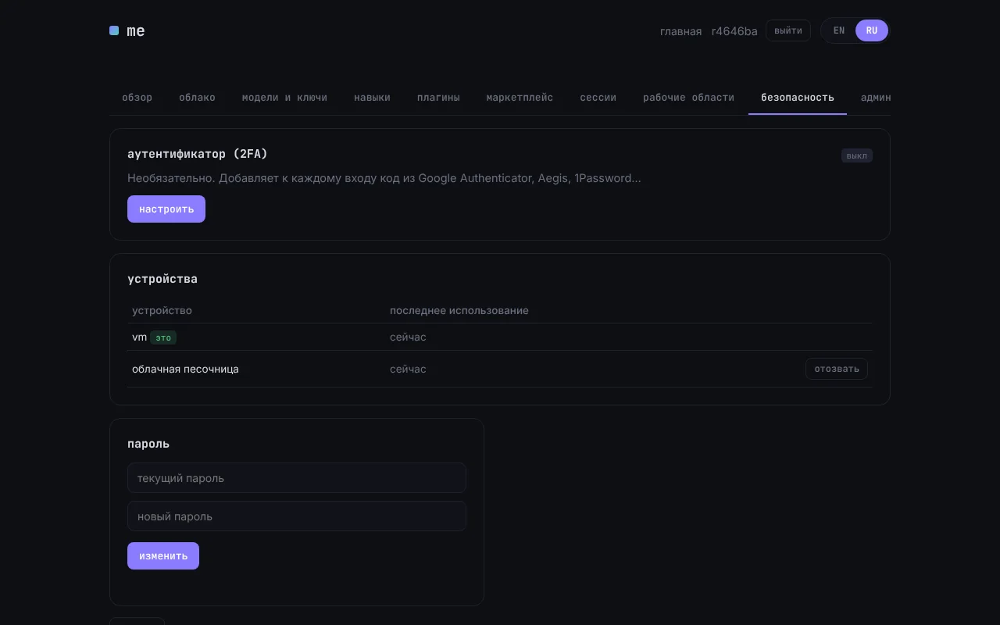</td>
</tr>
</table>

### Темы

У терминала, веб-приложения и сайта одна палитра. Выбирайте через `/theme` (с предпросмотром на лету) или ставьте новые из маркетплейса.


---

## Всё, что он умеет

### Агент

| | |
|---|---|
| **Один файл, без зависимостей** | `me.py` написан на чистом Python 3.8+ (только стандартная библиотека). Около 1k токенов системного промпта и инструментов на старте. |
| **Любая модель** | Любой OpenAI-совместимый API: chat/completions или responses, потоковый вывод, уровень рассуждений (none → xhigh), свои имена моделей и размеры контекста, синхронизация списка моделей с провайдером. |
| **Режимы агента** | `code` · `design` (сначала DESIGN.md, токены и компоненты, проверка на 360 и 1280 px) · `plan` (пишет PLAN.md, код не меняет) · `review` (только чтение, только настоящие баги) · `debug` (воспроизвести, найти причину, доказать) · `docs` · `research`. Из маркетплейса добавляются devops, tester, security, mobile, а свой режим пишется одним `.md` файлом. |
| **Цели** | `/goal "…"` работает автономно, пока цель не достигнута **и проверена**, либо точно объясняет, что мешает. В headless-режиме завершается кодом 0 или 2, поэтому подходит для CI. |
| **Планы и todo** | Живой чек-лист `todo` в терминале и в веб-интерфейсе. Перед «готово» агент проверяет себя: тесты, сборка, линтер, запуск кода. |
| **Субагенты** | `task(agent, prompt)` запускает любой режим в чистом контексте и возвращает короткий отчёт. |
| **AGENTS.md** | Всегда подгружается в сессию и виден в интерфейсе. `/init` создаёт файл, агент поддерживает его актуальным. Также подхватываются `ME.md`, `CLAUDE.md`, `DESIGN.md` и `PLAN.md`. |
| **Безопасные правки** | Несколько замен за вызов и правки по диапазону строк, понятные ошибки для слабых моделей. Контрольная точка на каждый ход: `/undo` возвращает файлы последнего хода, а веб-интерфейс показывает дифф с «оставить» или «откатить». |
| **Разрешения** | только чтение · спрашивать · полный доступ, плюс список разрешённых команд («всегда разрешать `npm test`»). |
| **Контекст** | Индикатор контекста, `/compact` и `/autocompact` до того, как окно переполнится. |
| **Стоимость** | Таблица цен по моделям, кеширование промпта, параллельные read-only инструменты. Стоимость задачи, сессии и дня с необязательными лимитами (`/cost`). |
| **Поиск и загрузка** | `web_search` через встроенный поиск DeepSeek (запасной вариант DuckDuckGo) и `web_fetch`. |

### Расширения

| | |
|---|---|
| **Навыки** | Один `.py` файл: инструкция плюс действия с индикатором прогресса, вопросами пользователю (`ctx.choose`), таблицами и секретами. Это не MCP: в простое около 15 токенов. Действия выполняются в отдельном процессе. Создайте из шаблона, попросите агента написать или поставьте по URL. |
| **Плагины** | Меняют сам me: команды, инструменты, клавиши, строку состояния, темы. Голосовой ввод (удерживайте пробел, Groq Whisper) поставляется как плагин. |
| **MCP** | Любой MCP-сервер, загружается лениво, как навык: одна строка в простое, схемы по запросу. |
| **Маркетплейс** | Навыки, плагины, темы и агенты с рейтингами, версиями и необязательным автообновлением. Можно публиковать своё. |
| **Темы** | me-dark, me-light, mono, mono-light, graphite, а из маркетплейса ещё Nord, Tokyo Night, Gruvbox, Catppuccin, Rosé Pine и другие. |

### Облако и синхронизация

| | |
|---|---|
| **Облачная синхронизация** | Конфиг, провайдеры, ключи, системный промпт, навыки, плагины, темы, агенты и каждый чат следуют за аккаунтом. Для документов действует правило «последняя запись побеждает». |
| **Живая синхронизация** | Каждый шаг агента сохраняется и отправляется. Другие устройства обновляются за секунду, поэтому сессию можно наблюдать с телефона. |
| **Рабочие области** | Папка проекта синхронизируется с облаком трёхсторонним слиянием. Тяжёлые и игнорируемые файлы пропускаются. Просматривать и клонировать можно со страницы аккаунта. |
| **Облачная песочница** | Сессии выполняются изолированно на сервере (bubblewrap, лимиты ресурсов). Начали на ноутбуке, продолжили на телефоне. Песочницы переживают перезапуск сервера. |
| **Фоновые задачи** | «Сделай X и сообщи»: задача продолжается после закрытия страницы. Расписания в стиле cron, push и Telegram по завершении. |
| **Предпросмотр** | Сайт, который собрал агент, открывается на телефоне по ссылке: статика или dev-сервер песочницы на `$PORT`. |
| **GitHub** | Токен в аккаунте позволяет агенту клонировать в рабочую область, создавать ветки, коммиты, делать push и открывать pull request. |
| **Telegram** | Свой бот у каждого аккаунта. Общайтесь с агентом из него (текстом или голосом), отвечайте на его вопросы кнопками, а инструмент `notify` присылает сообщения и файлы. |
| **Push-уведомления** | Web Push, когда задача закончилась и никто не смотрит. |
| **Голос** | Диктовка в терминале (удерживайте пробел) и в веб-интерфейсе, распознавание через Groq Whisper с вашим ключом. |
| **Аккаунты** | Логин и пароль, необязательная 2FA (Google Authenticator, Aegis, 1Password), смена пароля, список устройств с отзывом. |
| **Свой сервер** | Весь бэкенд лежит в этом репозитории. Укажите `ME_SERVER` на свой сервер. |

### Везде

TUI (компактный на узких терминалах) · `me web` на localhost · облачное веб-приложение (PWA) · приложение для Windows · приложение для Android · Telegram · headless `me -p` и JSON-lines `me --rpc` для вашего интерфейса.

## Команды

Наберите `/` и начните печатать, подсказки нечёткие.

| Команда | Что делает |
|---|---|
| `/help` | показать команды и клавиши |
| `/agent` | сменить агента (встроен только `code`, остальные — из маркетплейса) |
| `/init` | создать AGENTS.md для проекта |
| `/goal` | работать автономно, пока не готово и не проверено, либо не заблокировано |
| `/todo` | показать чек-лист агента |
| `/undo` | вернуть файлы последнего хода |
| `/perm` · `/yolo` | разрешения (чтение, спрашивать, полный) и список разрешённого · переключить полный доступ |
| `/cost` | расходы: ход, сессия, сегодня, лимиты |
| `/model` · `/provider` · `/effort` | смена модели · добавить или изменить провайдеров API · уровень рассуждений |
| `/prompt` | изменить системный промпт (синхронизируется) |
| `/skills` · `/plugins` · `/secret` · `/mcp` | навыки · плагины · секреты для навыков · MCP-серверы |
| `/new` · `/sessions` · `/clear` | новая сессия · продолжить прошлую · очистить экран |
| `/compact` · `/autocompact` | сжать контекст сейчас или автоматически |
| `/workspace` | синхронизировать папку проекта с облаком |
| `/theme` | цветовая тема (устанавливаемая) |
| `/copy` | скопировать последний ответ |
| `/login` · `/logout` · `/2fa` · `/sync` | облачный аккаунт · аутентификатор · синхронизация сейчас |
| `/config` · `/update` · `/quit` | настройки · обновить me · выйти |

## Использование

| Команда | Что делает |
|---|---|
| `me` | полноэкранный TUI, `/` открывает команды |
| `me web [порт]` | браузерный интерфейс с локальным агентом (`--lan` для других устройств) |
| `me -p "задача" [-y]` | разовый запуск без интерфейса |
| `me --rpc` | JSON-lines агент через stdio (так работает облачный раннер) |

`me -p '/goal "все тесты проходят"'` завершается с кодом 0, только если цель достигнута и проверена (2 значит «заблокировано»). Удобно в CI.

## Свой сервер

Сервер — это приложение FastAPI в `server/`, файлы для systemd и nginx лежат в `server/deploy/`. Запустите его на любой Linux-машине и направьте клиент на него:

```sh
export ME_SERVER=https://ваш-сервер.example
me
```

## Разработка

```
src/NN_*.py      агент, разбитый по задачам (TUI = отрисовка / ввод / команды)
src/web/         веб-интерфейс: index.html + style.css + NN_*.js
build.py         src/ → me.py (один файл, лежит в репозитории; CI проверяет, что он свежий)
server/          FastAPI: аккаунты, TOTP, синхронизация, рабочие области, раннер песочниц, Telegram, сайт
server/market/   встроенные навыки, плагины, темы и агенты
apps/            оболочки для десктопа (pywebview) и Android (WebView)
tests/           test_core.py (без сети) · test_cloud.py (нужен сервер) · test_restart.py · test_features.py (свой сервер)
                 screenshots.py (playwright, каждый интерфейс × 360/1280 × каждая тема) · measure_tokens.py (бюджет старта)
scripts/promo/   промо-ролики: запись терминала (pty+pyte), локальный стенд, веб-сцены на playwright, сборка ffmpeg
                 (scripts/build_promo.sh → dist/promo/; раскадровки в docs/promo/SCRIPTS.md)
scripts/readme_shots.py   пересоздаёт docs/screenshots/ (английский и русский)
```

Правьте `src/`, запускайте `python3 build.py`, затем `python3 tests/test_core.py`.

---

<div align="center">

[English version](README.md)

</div>
